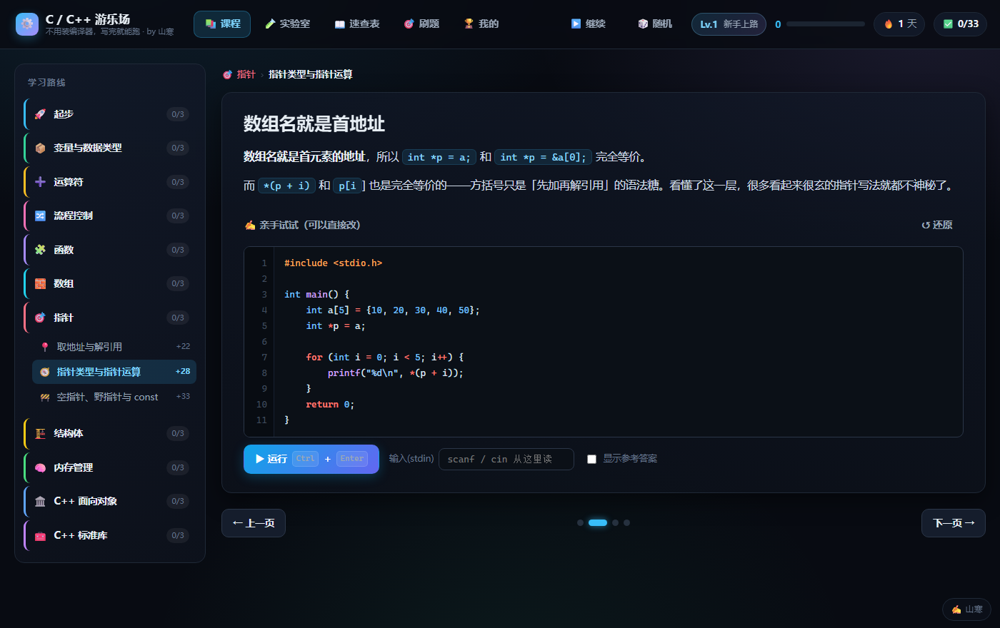
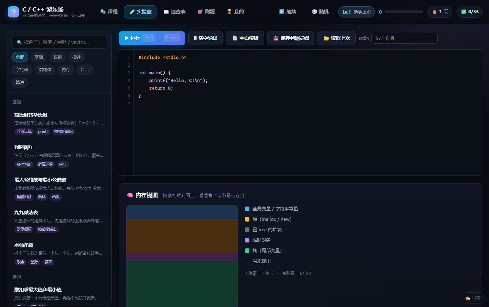

# ⚙️ C / C++ 游乐场

> 作者：**山寒** · 许可证：[Apache-2.0](LICENSE)

[](LICENSE)
[](#-为什么这么写)
[](#-为什么这么写)

**一个不用装编译器就能学 C / C++ 的网页。**

写完代码按 `Ctrl + Enter`，立刻看到结果 —— 而且还能**看见内存里发生了什么**：
每个变量住在哪个地址、指针到底指到了哪儿、函数调用时栈帧怎么一层层叠上去。

整个「编译器 + 运行环境」是一个从零手写的 C/C++ 子集解释器（词法 → 语法 → 执行），
配上一块**真实的平坦内存**，所以指针是真的在指，不是画出来的示意图。


---

## 🚀 快速开始

### 方式一：本地打开（推荐）

```bash
git clone <这个仓库的地址>
cd <仓库目录>
```

然后**双击 `index.html`**。

不需要 Node、不需要构建、不需要联网、不需要装任何东西。

### 方式二：在线玩（GitHub Pages）

这个项目是**纯静态**的，没有后端、没有依赖，所以可以直接开 Pages：

> 仓库 **Settings → Pages → Source 选 `Deploy from a branch` → 分支选 `main`、目录选 `/ (root)` → Save**

等一分钟，访问 `https://<你的用户名>.github.io/<仓库名>/` 就能玩了。

推荐用 Chrome / Edge / Firefox 的**较新版本**（代码里用了 `?.`、`??`、`Array.prototype.at` 等特性）。

---

## 🎮 有什么好玩的

### 📚 课程 —— 33 个小节，从 `Hello World` 走到虚函数

十一个章节，每节都遵循同一个节奏：

| 环节 | 干什么 |
|---|---|
| **讲解** | 一页一个知识点，代码可以当场改、当场跑 |
| **跑一跑** | 点「运行」，对照预期输出 |
| **猜输出** | 先想答案再揭晓，猜对了有 XP |
| **选择题** | 选完立刻告诉你为什么错 |

```
起步 → 变量与类型 → 运算符 → 流程控制
  → 函数 → 数组 → 指针 → 结构体
  → 内存管理 → C++ 面向对象 → C++ 标准库
```



进度存在浏览器本地（`localStorage`），关掉再开还在。

### 🧪 实验室 —— 这个项目的重点

左边写代码，右边同时给你三样东西：

1. **真实输出**（和终端一样，`stdin` 也能填）
2. **内存地图**：把 64 KB 的模拟内存画成热力图 —— 数据段、堆、栈各占一段，
   鼠标放到任意一个字节上，能看到它是谁在用
3. **地址表**：全局变量 / 每个栈帧的局部变量 / 堆上的每一块，各自在什么地址

指针不再是黑魔法 —— 你能**亲眼看到** `p` 里存的数字正好是 `a[0]` 的地址。



内置 36 个可运行范例，涵盖数组、指针、字符串、结构体、排序、递归、链表、C++ 类……

### 📖 速查表

语法关键词、格式串、运算符优先级、指针声明怎么读、常见报错是什么意思。

### 🎯 刷题 —— 76 道选择题

三个难度，九个主题（基础 / 数组 / 指针 / 字符串 / 结构体 / 内存 / C++ / 算法 / 易错）。
可以按主题、按难度筛，答完给解释。


### 🏆 我的

等级、经验值、连续学习天数、16 个成就、每个章节的完成度。

---

## 📁 文件结构

```
.
├── index.html                     ← 双击这个
├── LICENSE                        Apache-2.0
├── README.md
├── screenshots/                   界面截图（可以直接删掉，不影响运行）
├── css/
│   └── styles.css                 深色主题，无框架
├── tools/                         命令行小工具（可选，需要 Node.js）
│   ├── verify-all.mjs             全量校验：引擎 + 课程 + 题库
│   ├── try.mjs                    单例调试：只跑一道题 / 一个例子看结果
│   ├── dump.mjs                   打印某一页课程或某个范例的源码与期望输出
│   └── stamp-author.mjs           批量给源文件补上作者署名注释
└── js/
    ├── engine/                    自己写的 C/C++ 解释器
    │   ├── lexer.js               预处理（#define / #ifdef）+ 词法分析 + 宏展开
    │   ├── parser.js              递归下降语法分析 → AST
    │   ├── interpreter.js         解释执行 + 平坦内存模型 + 指针 + 栈帧
    │   └── selftest.js            56 个「标准答案」用例，可在页面里一键跑
    ├── data/
    │   ├── lessons-01-basics.js   起步 / 变量与类型 / 运算符 / 流程控制
    │   ├── lessons-02-adv.js      函数 / 数组 / 指针 / 结构体
    │   ├── lessons-03-pro.js      内存管理 / C++ 面向对象 / C++ 标准库
    │   ├── snippets.js            36 个可运行范例
    │   ├── quizbank.js            76 道选择题
    │   └── chapters.js            章节元数据 + 速查表内容
    └── app.js                     UI、路由、编辑器、进度、成就
```

全部是**经典 script**（没有 ES module、没有打包、没有 CDN），
所以在 `file://` 协议下直接双击也能跑。

---

## ⌨️ 快捷键

| 按键 | 作用 |
|---|---|
| `Ctrl + Enter` | 运行当前代码 |
| `Tab` | 缩进 4 格（选中多行时整块缩进） |
| `Shift + Tab` | 反向缩进 |
| `Enter` | 自动继承上一行缩进；行尾是 `{` 时自动多缩一级 |

---

## 🧠 这个模拟器支持什么

它是**真的在解释**你的代码，不是把几个例子硬编码 —— 变量有真实地址，指针真的能指来指去。

**内存模型**：ILP32 —— `char` 1 字节、`int` / `float` / 指针 4 字节、`double` / `long long` 8 字节；
总共 64 KB 平坦内存，数据段 → 堆 → 栈 依次排开。

**C 部分**：
- 类型：`char` / `short` / `int` / `long` / `long long` / `unsigned` 系列 / `float` / `double` / `bool`
- 运算符全套，含位运算、三目、逗号、复合赋值、前后缀 `++` `--`
- `if` / `switch`（含贯穿）/ `for` / `while` / `do-while` / `break` / `continue` / `goto`
- 函数、递归、值传递、数组参数退化
- 数组（一维 / 多维）、字符串字面量、指针（含指针的指针、函数指针调用）
- `struct` / `union` / `enum` / `typedef`、位域（基础支持）
- `malloc` / `calloc` / `realloc` / `free`
- `printf` 大部分格式串、`scanf`（从「输入」框读）、`strlen` / `strcpy` / `strcmp` 等常用库函数

**C++ 部分**：
- `class` / `struct`、构造 / 析构 / 拷贝构造、`this`
- `public` / `private` / `protected`、继承、`virtual` 动态绑定
- 引用 `&`、函数重载（按参数个数与类型区分）、默认参数
- `new` / `delete` / `new[]` / `delete[]`
- `std::string`、`std::vector`（含迭代器 `it++` / `*it`）、`std::sort`（含自定义比较器）、`std::pair`
- 运算符重载（`+` / `-` / `*` / `==` / `[]`）、`greater<int>()`
- `cout` / `cin` / `endl`（包括 `<<` 链式调用、char 按字符打印）
- 范围 `for`（`for (int x : v)`、`for (auto &x : v)`）、`auto`、`nullptr`、`namespace`

### ⚠️ 它做不到什么

诚实地说清楚，免得你被坑：

- **不是真编译器**。它按 C/C++ 的语义逐句解释，不做完整的前端类型检查，
  有些错误的报错文字会和 gcc 不一样（但**行为**尽量对齐）。
- **没有模板**。`vector<int>` 是内置支持的，你自己写 `template<class T>` 不行。
- **没有多文件**。`#include` 会被识别并跳过，不会真的去找头文件。
- **没有完整标准库**。常用函数有，冷门的没有。
- **浮点用 JS 的 double 算**，`float` 的精度损失是模拟出来的，极端情况下和真实硬件有差异。
- **有资源上限**（防止死循环卡死浏览器）：单次运行约 3 秒 / 800 万步；堆 20 KB、栈 32 KB。
  写算法题够用，跑大程序不够。
- **整数不会回绕**：`int` 的加减乘是用 JS 的数字算的，
  `printf("%d\n", 2147483647 + 1)` 会打印 `2147483648`，而不是真机上的 `-2147483648`
  （写回内存时才会截成 32 位）。`unsigned` 和 `int` 混着比较也不做隐式转换。
- **`sizeof(vector<int>)` 是 16**（libstdc++ 真机是 24），这是模拟器自己的约定。

上面每一条都在 `js/engine/selftest.js` 或 README 里写明了，不会假装自己支持。

---

## 🔍 自检：怎么确认引擎没算错

### 方式一：页面里点一下（不用装任何东西）

打开 **🧪 实验室**，拉到最下面，点 **「跑一遍全部 56 项」**。

这 56 个用例覆盖了最容易写错的地方 —— 整数除法截断、`-7 % 3`、
指针步长、`sizeof` 数组退化、结构体值拷贝、构造 / 析构顺序、
`%g` 的指数格式、`unsigned` 回绕、`switch` 贯穿、虚函数绑定、引用传参……

每一项都有**精确到换行和空格的期望输出**。全绿就说明这个模拟器的行为和真实 C/C++ 一致。

### 方式二：命令行全量校验（需要 Node.js）

```bash
node tools/verify-all.mjs
```

它会做四件事：

1. 把 `js/engine/*.js` 加载进一个沙箱（不需要浏览器）
2. 跑那 56 项引擎自检
3. 把课程数据里**每一段** `expect` 和**每一个** snippet 真正执行一遍，**逐字节**比对输出
   —— 这才是真正在验证课程内容没写错，而不只是引擎没写错
4. 静态检查所有选择题：`answer` 下标越界、选项重复、`chapter` / `topic` / `level` 非法、`id` 重复

全部通过退出码 0，有问题退出码 1 并逐条列出 `文件:行号` 和「期望 / 实际」。

当前状态：

```
✓ 引擎自检            56 / 56
✓ 课程页面代码        100 段
✓ 可运行范例          36 段
✓ 课程选择题          99 道
✓ 题库选择题          76 道
✓ 未发现问题
```

> 这个脚本是纯 Node 标准库写的（只用 `node:vm` / `node:fs` / `node:path`），
> 不装任何依赖，`node tools/verify-all.mjs` 直接就能跑。
> 跑出来的 `verify-report.txt` 已经在 `.gitignore` 里，不会污染仓库。

### 方式三：只想看某一个跑出什么

```bash
node tools/try.mjs list                  # 列出全部自检用例
node tools/try.mjs selftest 指针步长       # 只跑名字里带「指针步长」的用例
node tools/try.mjs lesson pointer-2 2    # 跑 pointer-2 这个小节的第 2 页
node tools/try.mjs snippet sn-cpp-sort   # 跑某个范例
node tools/try.mjs quiz q-ptr-008        # 看某道题库题
node tools/try.mjs file my.cpp           # 跑任意一个 .cpp 文件
```

加 `--src` 会先把源码打出来。改课程数据的时候用这个，比在浏览器里点半天快。

---

## ➕ 想加自己的课程 / 题目？

课程数据就是普通的 JS 对象数组，照着现有文件的格式加就行，不用改任何引擎代码。

**加一个小节**（丢进任意 `js/data/lessons-*.js`）：

```js
{
  id: 'my-lesson',              // 全局唯一
  chapter: 'pointer',           // start|types|ops|flow|func|array|pointer|struct|memory|cpp-oop|cpp-stl
  title: '我的小节',
  icon: '🎈',
  xp: 30,
  pages: [{
    title: '页面标题',
    body: '正文，支持 [[行内代码]] 和 **加粗**。',
    code: 'int main() {\n    printf("hi\\n");\n    return 0;\n}',
    expect: 'hi\n'              // 期望的精确输出；不填就不显示对照
  }],
  challenges: [{
    type: 'choice',             // 或 'predict'（先猜输出）
    question: 'printf 返回什么？',
    options: ['输出的字符数', '0', '1', '地址'],
    answer: 0,                  // 正确选项的下标
    explain: 'printf 返回成功写出的字符个数。'
  }]
}
```

**加一道刷题**（`js/data/quizbank.js`）：

```js
{
  id: 'q-xxx',
  topic: '指针',               // 基础|数组|指针|字符串|结构体|内存|C++|算法|易错
  level: 'mid',                // easy|mid|hard
  q: '题干',
  code: 'int a[3]; ...',       // 可选，会带语法高亮显示
  options: ['A', 'B', 'C', 'D'],
  answer: 2,
  explain: '为什么 C 对。'
}
```

加了新章节的话，记得在 `js/data/chapters.js` 的 `CHAPTERS` 里补一条元数据。

改完跑一遍 `node tools/verify-all.mjs`，它会告诉你每一段 `expect` 跟真实输出差在哪。

---

## 🛠 为什么这么写

- **不用框架**：整个 `app.js` 是原生 DOM。没构建步骤，改完存盘刷新就见效。
- **不用 ES module**：`file://` 下浏览器会因为 CORS 拒绝加载 module，
  而「双击就能用」是这个项目的硬要求。所以全部用 `window.XXX` 挂全局。
- **不用 `eval`**：解释器是自己写的词法 / 语法 / 求值三段，代码跑在沙箱里，
  只能碰那 64 KB 的模拟内存，碰不到页面。
- **零依赖**：`package.json` 都没有。唯一的第三方是 `tools/` 里的校验脚本，而且只用 Node 内置模块。

---

## 📄 许可证

[Apache License 2.0](LICENSE) © 2026 山寒

---

祝你玩得开心。要是发现哪个例子的输出跟真实编译器对不上，那就是这个模拟器的 bug ——
把它记下来，修 `interpreter.js` 就好。 🙂

---

<sub>**English:** A zero-dependency, build-free web playground for learning C/C++.
It ships a hand-written C/C++ subset interpreter (lexer → parser → tree-walking evaluator) with a
real flat 64 KB memory model, so pointers genuinely point. Just open `index.html` — no compiler,
no npm install, no server required. Licensed under Apache-2.0.</sub>
